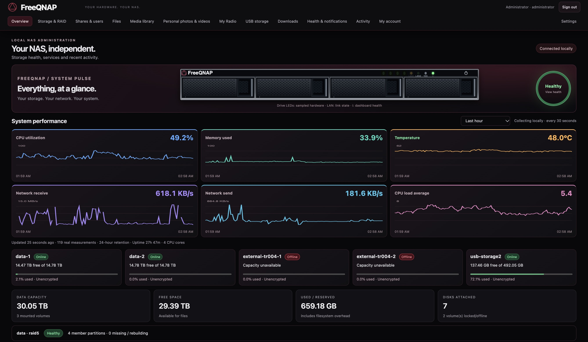
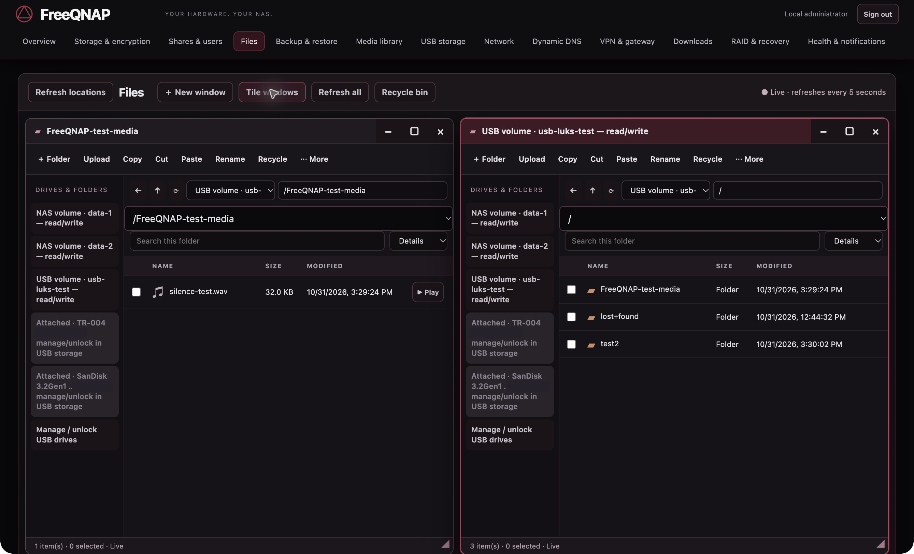
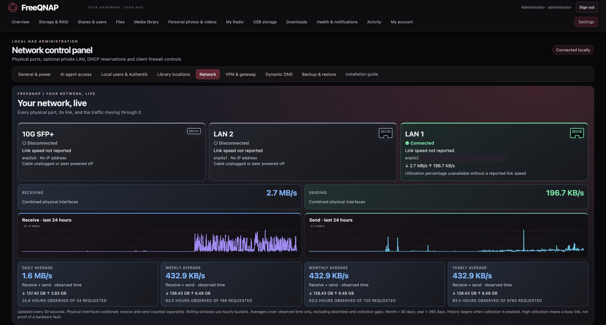

<p align="center"></p>
<h1 align="center">FreeQNAP</h1>
<p align="center"><strong>Keep useful hardware useful.</strong><br>Locally managed Debian and a modern NAS dashboard for the QNAP TS-431XeU.</p>
<p align="center"><a href="https://mastechnica.github.io/FreeQNAP/">Project showcase</a> · <a href="docs/tutorial/index.html">Illustrated installation guide</a> · <a href="docs/CURRENT-STATUS.md">Current status</a> · <a href="docs/PRODUCTION-READINESS.md">Acceptance checklist</a></p>



**Experimental source project · 31 October 2026.** FreeQNAP is running on real
TS-431XeU hardware. The owner approved this source publication under
[mastechnica/FreeQNAP](https://github.com/mastechnica/FreeQNAP). No prebuilt OS image
is included. The public installer workflow
and several recovery/hardware acceptance gates remain unfinished. Do not put
irreplaceable data on an unaccepted installation.

## Your hardware. Your NAS.

FreeQNAP combines **Debian 13 ARMhf**, model-specific enclosure support and a
locally managed browser application. No cloud account, fleet manager or external
telemetry service is required. Optional metadata searches, DDNS, email and browser
push contact their configured providers only when enabled or explicitly requested.

The supported target is **TS-431XeU-2G-US, Annapurna Labs AL314, 32-bit ARM**.
Related TS-431 models are research references, not compatible installation targets.
This independent project is not affiliated with or endorsed by QNAP.

## What you can manage

| Workspace | Included functions |
| --- | --- |
| Overview | Graphical front panel, sampled LEDs, active alerts, CPU/RAM/temperature/traffic history, disk and capacity summaries |
| Storage & encryption | Identity-bound RAID planning, bounded ext4 volumes, LUKS2 password/key unlock, recovery-key/header tools, SMART reports/history and optional test schedules |
| Shares & users | SMB, NFSv4 and AFP configuration, explicit users and permissions, optional Time Machine settings |
| Files | Independent folder windows, tile/resize, drag and drop, upload/download, right-click actions, copy/move/rename/duplicate, recycle retention, ZIP creation/extraction/download and native media viewing |
| Backup & restore | Encrypted Restic repositories, local or pinned SFTP destinations, schedules, verification, staged file restoration and downloadable encrypted NAS configuration archives |
| Media library | Cover-art browsing, plot/cast/crew, local NFO, optional TVmaze/OMDb lookup, metadata/art editing, frame captures, direct play, fullscreen and browser-dependent picture-in-picture |
| DLNA access | Network discovery with explicitly approved clients; browser/client codecs still determine playback compatibility |
| USB storage | Attached-drive cards, capacity, lock state, safe eject, managed ext4/LUKS import and format-specific foreign readers |
| Network | Every physical port, connected/disconnected state, traffic charts and observed-period averages; DHCP/static settings, routes, DNS and optional isolated private LAN/client controls |
| VPN & gateway | OpenVPN/WireGuard client/server configuration, peer status, opt-in gateway forwarding, untrusted-tunnel firewall and fallback-WAN denial |
| Dynamic DNS | Multiple opt-in provider profiles with address checks, provider acceptance history and independent retry/backoff |
| Downloads | Graphical HTTP(S), magnet and torrent queue; pause/resume, saved partials, transfer progress and independent retries |
| RAID & recovery | Array inspection, synchronization, guarded import/replacement/check operations and explicit recovery staging |
| Health & notifications | Persistent incidents, rules/presets, optional email and Web Push, buzzer enable/timed/permanent silence and a health-linked physical status light |
| Local administration | Trusted LAN HTTPS, separate dashboard enrollment, key-only root SSH by default, installable PWA and durable activity history |

Source implementation and fixture tests do not imply acceptance of every real
client, physical fault, provider or recovery case. Read the current status before
enabling a service.

## A file desktop in your browser



Open several folders at once, choose mounted NAS or USB volumes, and manage files
with familiar controls. This real capture uses existing test folders on an
unlocked disposable LUKS/ext4 drive. Device identity labels are masked.

## See the whole network



All physical ports remain visible, including disconnected ports. Live rates and
hourly aggregates stay local. Daily, weekly, 30-day and 365-day averages explicitly
show observed coverage: they do not invent a year of data on a new installation.
Negotiated link speed is unavailable from this driver and is shown as unknown.

## Start here

| Goal | Read |
| --- | --- |
| Explore the application | [Visual project page](docs/index.html), [dashboard UX](docs/DASHBOARD-UX.md) |
| Convert the exact supported NAS | [Photographed tutorial](docs/tutorial/index.html), [installer walkthrough](docs/INSTALLING.md), [installer tools](installer/README.md) |
| Understand hardware support | [Engineering record](docs/HARDWARE.md), [validation plan](docs/VALIDATION-PLAN.md) |
| Manage storage and recover files | [Storage & backups](docs/STORAGE-BACKUPS.md), [configuration recovery](docs/CONFIGURATION-RECOVERY.md) |
| Use encrypted USB drives | [Format compatibility](docs/ENCRYPTED-USB.md), [TR-004 and controller workaround](docs/USB-TR004.md) |
| Configure networking and services | [Network control](docs/NETWORK-CONTROL.md), [VPN/downloads/DLNA](docs/VPN-DOWNLOADS-MEDIA-ACCESS.md), [DDNS](docs/DYNAMIC-DNS.md) |
| Configure media, alerts and access | [Media library](docs/MEDIA-LIBRARY.md), [disk health & notification rules](docs/DISK-HEALTH-AND-NOTIFICATIONS.md), [HTTPS](docs/LOCAL-HTTPS.md) |
| Assess readiness | [Current status](docs/CURRENT-STATUS.md), [acceptance record](docs/ACCEPTANCE.md), [production gates](docs/PRODUCTION-READINESS.md) |
| Review licensing and publication | [Sources](docs/SOURCES.md), [license scope](licenses/README.md), [publication package](docs/PUBLICATION-PACKAGE.md) |

## What is established—and what is not

**1 November update:** initial internal RAID5 synchronization is complete.
Post-sync bounded physical-filesystem backup/restore and native file-backed RAID5
recovery passed. Physical disk failure/rebuild, independent disaster recovery and
post-write cold-start acceptance remain open. [Validation details](docs/VALIDATION-2026-11-01.md).

Installed NAND boot, warm restarts, a physical cold start, four-disk enumeration,
RJ45 traffic, fixed full cooling and enclosure controls have observed evidence.
The EJ188 USB first-write failure has a narrowly checked PCIe MRRS workaround,
with bounded direct-write/readback tests; the attached TR-004 is not a commissioned
external NAS filesystem. Existing physical LUKS/ext4 read/write and experimental
encrypted APFS read-only browsing/media checks are recorded separately.

The four-disk internal RAID5 array is initialized with two bounded unencrypted
ext4 data filesystems. **Initial synchronization was still running at this review.**
The screenshot preserves the resulting critical protection alert. Physical
failure/rebuild, independent backup/restore, post-write cold starts and sustained
client workloads remain acceptance gates. RAID, a recycle bin and a second copy
inside the same chassis are not independent disaster protection.

SFP+ traffic, adaptive cooling, watchdog expiration and wake remain unaccepted.
Full flash/bootloader restoration is excluded. There is no 4K transcoding service,
no universal encrypted-disk compatibility claim, and no per-user DLNA folder
isolation. APFS access is experimental/read-only; BitLocker browsing still lacks
complete acceptance. Public binary release requires clean builds, corresponding
source/license packaging, signed artifacts and a tested update/recovery path.

The illustrated UART connector guide marks the owner-confirmed far-right GND
and leaves other positions/voltage explicitly unmeasured. Never power the board
from the USB UART adapter or assume a related model's pinout is verified here.

## Preview locally

Project page (static, no installation or disk access):

```sh
python3 -m http.server 8767 --bind 127.0.0.1 --directory docs
```

Open <http://127.0.0.1:8767/>. To inspect the application with synthetic read-only
fixtures instead:

```sh
python3 -m freeqnap.server --demo --state /tmp/freeqnap-preview-state --backups /tmp/freeqnap-preview-backups --port 8766
```

Open <http://127.0.0.1:8766/>. Demo data is illustrative; modifying requests are
refused and host disks are not inspected. The application needs no JavaScript
build, remote font or analytics service. Live services require their documented
Debian dependencies.

## Development checks

```sh
python3 -m unittest discover -s installer/tests -v
python3 -m unittest discover -s tests -v
python3 tools/check-package.py
```

Fixture tests do not program hardware or certify recovery. The release review
also checks static links, image redaction receipts and the complete package
inventory. See [publication preparation](docs/PUBLICATION-PACKAGE.md).

Original FreeQNAP code is MIT, subject to final owner license review. Linux-derived
files retain their GPL terms and notices. This source-only package contains no OS
images, vendor firmware, private flash dumps, keys, credentials, runtime databases
or previous private project history. Screenshot crops and opaque masks are
[documented](docs/assets/screenshots/PROVENANCE.md); no status or metric was fabricated.

Agent integration: [local API tokens, permissions and approved-player playback](docs/AGENT-API.md).

USB protection: [encryption profiles, password/key files and safe mounting](docs/USB-ENCRYPTION.md).
